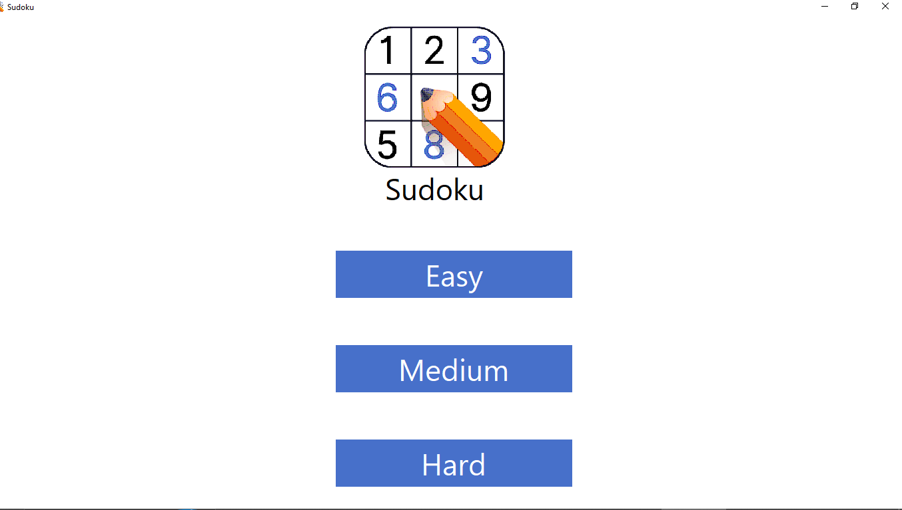
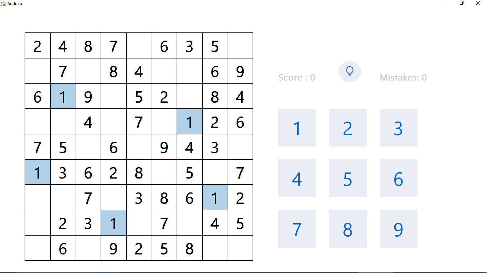
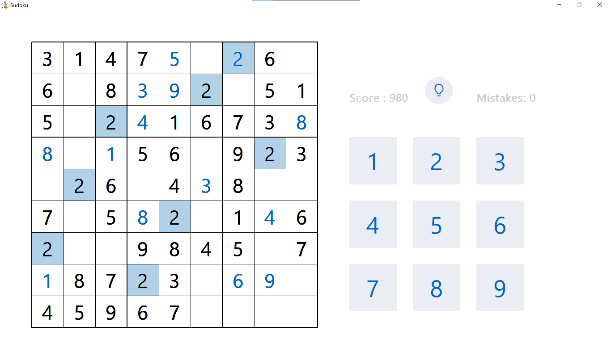

#  Sudoku
This is a basic beginner Sudoku project made with the C language using Windows API. It
It has a GUI and you can play Sudoku puzzles with custom difficulty.

#  Prerequisites
-  GCC compiler 
-  Windows operating system

# Features
- 🎚️ Custom levels according to your capability 
- 🖱️ click an empty cell then use keyboard or buttons on the screen to enter the number.
- 💡 The game features 3 hints for you to use when you get stuck.
- 🎨 the GUI is super clean and modren with live score/mistakes tracking and cell highlighting.

#  How to run 
```
make run
```

If you don't have make installed run this  
```
./main.exe
```
# Demo Screenshots 







